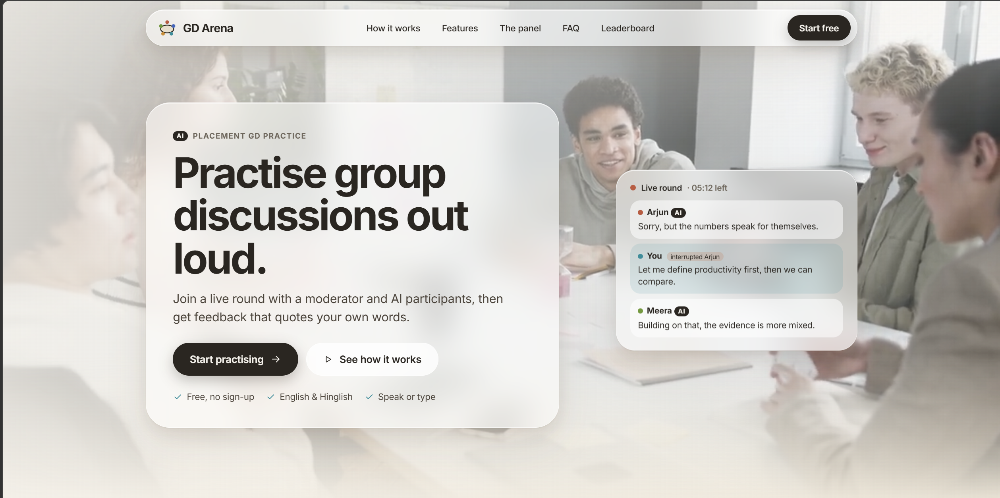
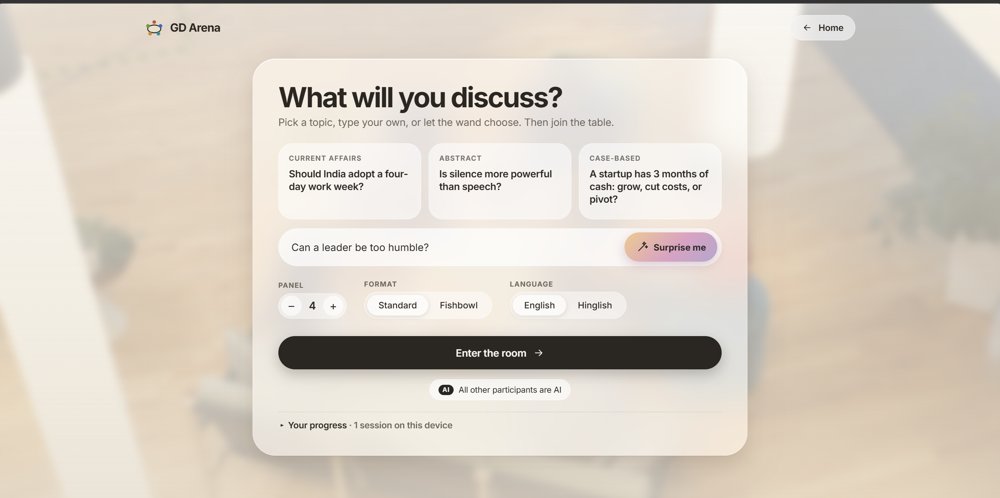
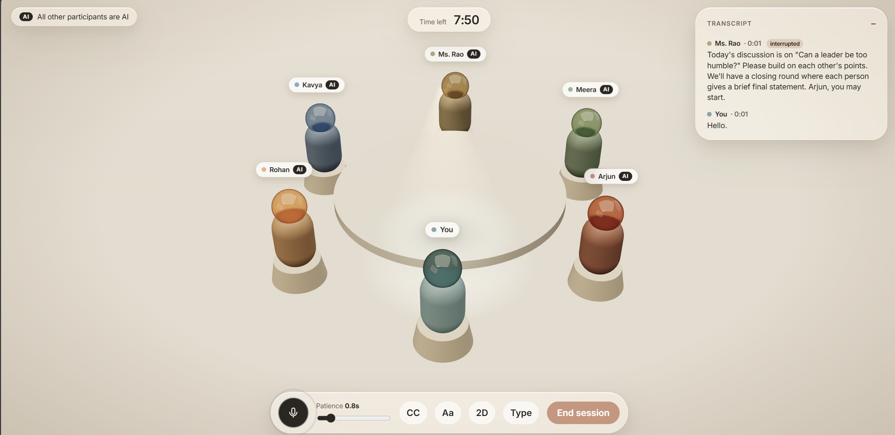
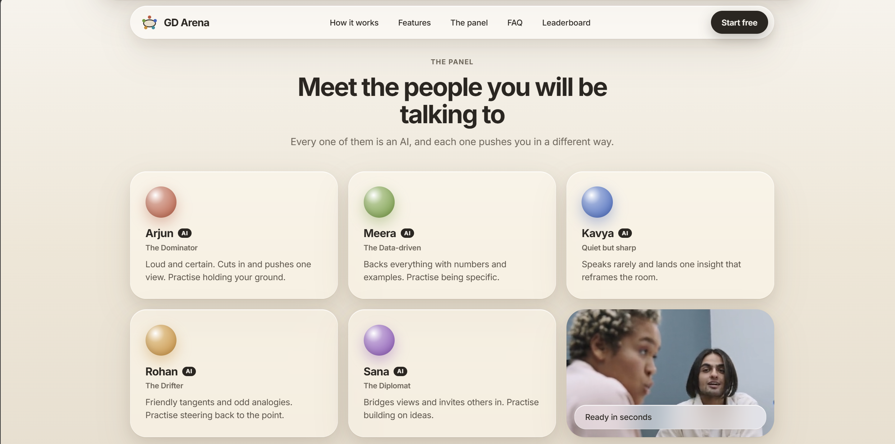
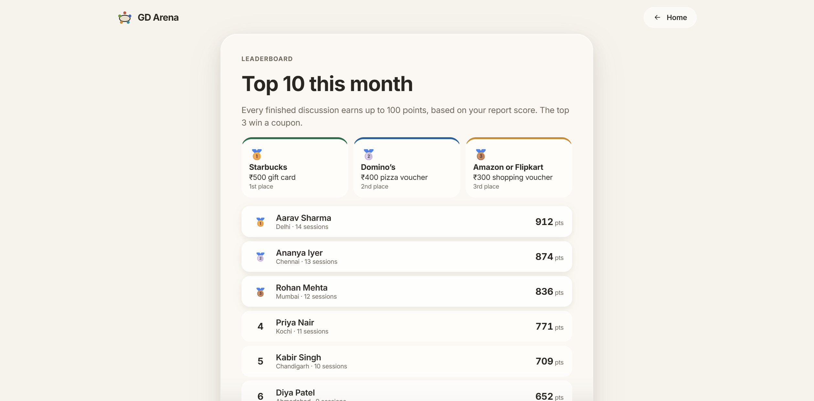

# GD Arena

**A voice-first room where students practise placement Group Discussions against AI participants, then get honest feedback that quotes their own words.**

Built for the hackathon problem statement *"GD Arena: build the room where students practise group discussions."*

**Presentation:** [GD Arena deck (PDF)](docs/GD_Arena_Nexoryx.pdf), Team Nexoryx.

> [!IMPORTANT]
> **For the best experience, run GD Arena locally on a laptop with an NVIDIA RTX GPU** (tested on an RTX 4060, 8 GB).
>
> GD Arena is voice-first, so the voices matter most. Run locally, every AI participant speaks through **Kokoro** on your own GPU: natural, expressive voices that make the room feel like a real GD.
>
> The hosted version runs on free cloud servers with no GPU, so it cannot run Kokoro. It uses Edge TTS voices instead, which sound flatter. The free backend also sleeps when idle, so the first load can take about 50 seconds. Everything else works the same, but the discussion feels noticeably less real.
>
> Setup takes about 10 minutes: see [Setup on Windows](#setup-on-windows).



## The problem

A Group Discussion is one of the toughest campus-placement rounds, and almost nobody can practise it properly. You need 6 to 8 people, a moderator and a topic, and even then nobody gives honest feedback. GD Arena gives every student that room on demand.

## What it does

| | |
|---|---|
|  |  |
| **Set up a room.** Pick from a topic list, type your own, or let the wand choose. Choose 3 to 5 AI participants, Standard or Fishbowl format, English or Hinglish. | **Live spoken discussion.** A 3D round table with a spotlight on the speaker, live captions, a timer, an adjustable patience slider and a typing fallback. |
|  |  |
| **A panel with personalities.** Arjun the dominator, Meera the data-driven one, Kavya the quiet one, Rohan who drifts off topic, Sana the diplomat. Each has its own instructions and its own voice. | **Leaderboard.** Every finished discussion earns up to 100 points from your report score. The top 3 win a coupon (Starbucks, Domino's, Amazon or Flipkart). Sample players fill the board in this demo. |

## Problem statement checklist

| Requirement | How GD Arena does it |
|---|---|
| Set up a room: topic list, custom topic, 3 to 5 AI plus a moderator | Setup screen with suggested topics, a custom box and a panel stepper |
| Live spoken discussion with live transcription | Mic capture, Chrome Web Speech captions, Whisper fallback; AI answers out loud in separate voices |
| Natural turn-taking | The server owns the floor. AIs wait for a pause, never talk over each other, stop the moment you speak, and reply to each other |
| Structure | Moderator opens, countdown timer, closing round |
| Report | Talk share plus scores for opening, ideas, building on others, listening, interruptions and ending. Every point links to a quote in the transcript, and the code checks the quote really exists |
| Distinct participants | Separate persona prompts and separate voices |
| Speed and resilience | One LLM call per turn, sentence-by-sentence speech; handles denied mic, dropped connection (resume), failed AI, TTS or STT calls |
| Tell the student the others are AI | **AI** badge on every participant, in setup, room, report and footer |
| Make it yours | Fishbowl format, Hinglish room, adjustable patience, live captions with text sizes, "what you could have said" moments, progress over sessions, points leaderboard |

## Tech stack

**Frontend:** React 19, TypeScript, Vite, Three.js (React Three Fiber, drei), Framer Motion, Web Audio API, Web Speech API, localStorage.

**Backend:** Python, FastAPI, Uvicorn, WebSocket, Pydantic, pytest.

**AI and voice:** Groq (`gpt-oss-120b` for turns and reports, `gpt-oss-20b` as the fast fallback), Whisper for speech-to-text fallback, Kokoro on a local GPU for text-to-speech, Edge TTS as fallback and for Hindi voices.

## Known limits

- The leaderboard shows sample players and keeps your own points in this browser only. A shared board needs a backend that stores scores per user.
- Live captions need Chrome. Other browsers fall back to Whisper, a few seconds slower.
- Friends joining the same room is not built.

---

## Setup, usage and internals


- Voice-first: speak, see live captions, hear the AI panel answer, interrupt them and they stop.
- A 3D round table with a spotlight that glides between speakers (2D fallback for weak devices, reduced motion, or no WebGL).
- Five distinct AI personas plus a moderator. Every AI is labelled **AI** in the setup, the room and the report.
- Free services only: Groq (LLM + Whisper), Kokoro on your GPU, Edge TTS, browser speech.

## Setup on Windows

You need Windows 10/11, Node 20+, Python 3.12 (3.10 to 3.12 work; **3.13 cannot install current Kokoro**), and optionally an NVIDIA GPU.

1. **Groq key.** Create a free key at https://console.groq.com and put it in a `.env` file at the project root (`.env.example` shows the format):
   ```
   GROQ_API_KEY=gsk_...
   ```
   Optional overrides: `GROQ_MAIN_MODEL` (default `openai/gpt-oss-120b`) and `GROQ_FAST_MODEL` (default `openai/gpt-oss-20b`). Groq retired the Llama 3.x models, so these are the replacements.
   The backend also reads `backend/.env`; copy the file there too.

2. **Backend (Python 3.12 virtual environment).**
   ```powershell
   cd backend
   py -3.12 -m venv .venv312        # or: conda create -p .venv312 python=3.12
   .\.venv312\Scripts\python -m pip install -r requirements.txt
   ```
   Kokoro text-to-speech (local, GPU):
   ```powershell
   # CUDA build of PyTorch (cu124 works on RTX 20/30/40 series; use the CPU wheel if you have no NVIDIA GPU)
   .\.venv312\Scripts\python -m pip install torch --index-url https://download.pytorch.org/whl/cu124
   .\.venv312\Scripts\python -m pip install -r requirements-kokoro.txt
   ```
   **espeak-ng** is required by Kokoro. The `espeakng-loader` package (installed with Kokoro's dependencies) ships it, so no separate install is normally needed. If Kokoro still reports a missing espeak-ng, install it system-wide with `winget install eSpeak-NG.eSpeak-NG`.

   If Kokoro is missing or fails to load, the app still works: speech falls back to Edge TTS, then to your browser's speech synthesis.

3. **Frontend.**
   ```powershell
   cd frontend
   npm install
   ```

4. **Run everything** from the project root:
   ```powershell
   .\dev.ps1
   ```
   Open http://localhost:5173 in **Chrome** (best: live captions use the Web Speech API). Allow the microphone. **Use headphones**, otherwise the AI voices can leak into your mic.

   The first start takes about 30 to 60 seconds while Kokoro loads and warms up its voices. `http://127.0.0.1:8000/health` shows `"kokoro": true` when it is ready.

## Site structure

- **Landing page** (`/`): hero video, how it works, features, feedback preview, the AI panel, FAQ. Content lives in `frontend/src/landing/content.ts`; the FAQ also feeds the FAQ structured data.
- **Topic page** (`/#/practice`): three suggested topics, a custom topic box, the **Surprise me** wand for a random topic, and compact panel / format / language options.
- **Room** and **Report** follow from there. The browser back button works between landing and topic page.
- **Videos**: web-sized copies (720p, no audio, about 4 MB in total) are in `frontend/public/media/`. They play only while visible and show a still image if the visitor prefers reduced motion.
- **SEO**: title, description, Open Graph and Twitter tags and `WebApplication` structured data are in `frontend/index.html`; `robots.txt` is in `public/`.

## Using it

1. Pick a topic (or type one), panel size, format and language, then **Enter the room**.
2. The moderator opens. Talk when you like; the AIs wait for a pause (adjust **Patience** in the dock), reply to you and to each other, and stop the moment you speak.
3. Keyboard / no mic: press **Type** and enter your answers. This also appears automatically if the microphone is denied.
4. At the one-minute mark everyone gives a closing statement. **End session** any time to get the report.
5. The report shows speaking share, six scored areas, quote chips that jump to the transcript line, and three "what you could have said" moments. Your last sessions are summarised on the setup screen (saved only in your browser).

Formats: **Standard**, or **Fishbowl** (you watch the first few exchanges, then the moderator invites you in). Languages: **English** or **Hinglish**.

## Useful URLs

| URL | What it does |
|---|---|
| `/?sim=1` | Scripted simulator instead of the live backend (UI work, no keys needed) |
| `/?mode=2d` | Force the 2D table (`?mode=3d` forces 3D) |
| `/?demo=report` | Jump straight to a sample report (calls the real report endpoint) |
| `/?test=1` | Exposes `window.__gd.drop()` to simulate a lost connection |

## Tests

```powershell
cd backend
.\.venv312\Scripts\python -m pytest -q tests
```
37 tests cover the turn engine (validation, retry, rate-limit and timeout fallbacks), report validation (quotes must exist verbatim in the transcript) and the session (barge-in, fishbowl, reconnect). They run offline with a fake Groq client.

## How it fits together

```
frontend (React + R3F)  <--WebSocket /ws-->  backend (FastAPI)
  mic, VAD, captions                            Session: floor control, timer, transcript
  audio queue + analyser                        turn_engine: one Groq call per turn, JSON-validated
  3D / 2D table, glass UI                       tts: Kokoro -> Edge -> browser speech
  report + progress                             stt: Groq Whisper   report: scored feedback + quote check
```

- One LLM call per turn: the model picks the speaker and writes a 1 to 3 sentence line as strict JSON, validated with Pydantic, retried once, then a moderator question as fallback.
- The backend owns the floor (`idle`, `ai_speaking`, `student_speaking`). When you start speaking the client stops audio immediately and the line is marked **interrupted** in the transcript.
- The report asks the model for feedback with quotes, then checks every quote against the transcript in code. Quotes that cannot be matched are repaired to the nearest real words or dropped.

## Troubleshooting

- **No AI voice / robotic voice:** check `/health`. `kokoro: false` means Edge TTS or browser speech is in use; the log says why.
- **Port 8000 already in use after stopping the servers:** an old uvicorn worker may still be running. Run `taskkill /PID <pid> /T /F` on the whole process tree (find it with `Get-NetTCPConnection -LocalPort 8000`).
- **Live captions missing:** Web Speech needs Chrome and internet access. The app then records each utterance and transcribes it with Whisper after you stop (a few seconds slower).
- **AI hears itself:** use headphones.
- **The AI pauses or repeats "let's hear from you":** Groq's free tier allows about **8,000 tokens per minute per model** and about **1,000 requests per day**. The app keeps its prompts small, tracks each model's usage and switches between `gpt-oss-120b` and `gpt-oss-20b` when one is busy (see `backend/server.err.log` for `429` lines). If both stay busy for a minute, the moderator steps in with a question and the round continues. A new free key or the paid tier removes the limit.
- **You talk but nothing happens:** the app ends your turn when you stop talking. If your room is noisy it judges noise against how loud *you* are, caps an answer at 20 s, and the server ends a stuck turn after 10 s. Use headphones and a quieter spot if it still misbehaves, or press **Type**.
